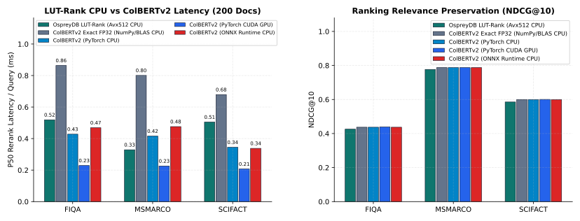
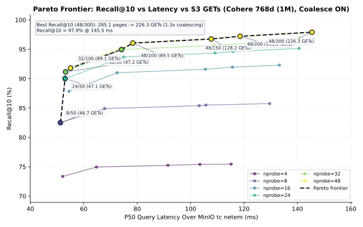

# OspreyDB Benchmarks

[](./LICENSE)

Reproducible benchmark suite for **[OspreyDB](https://github.com/ospreydb/ospreydb)**. Evaluates three subsystems against production baselines: recall-matched single-vector ANN search (`OspreyDB` 1-bit RaBitQ + `f16` rescore vs. `Qdrant` HNSW FP32 / INT8 SQ8 / 1-bit BQ, and `pgvector` HNSW FP32 / FP16 `halfvec`), late-interaction reranking (`LUT-Rank` AVX-512 CPU vs. ColBERTv2 on CPU and CUDA GPU), and object-storage vector search (DP range coalescing with Hilbert page layout over MinIO with `tc netem 15ms` latency).

## Results

### SIFT1M (1M × 128d)

Recall-matched evaluation (`Recall@10` targets `0.95` and `0.97`, 925 unique test queries, 16 concurrent workers via Rust `http-load` for HTTP engines, L2-normalized SIFT1M vectors, OspreyDB bounded to `--controlled-cache-mb 256`—which exceeds the `.osv` slab size on both `1M×128d` (`213 MiB` total) and `100k×768d` (`152 MiB` total)—and symmetric query-only `cgroup v2 memory.peak` after post-build page-cache eviction). Note that `osprey-bench-runner serve` is a static read-only HTTP wrapper (not a full transactional DB), `build_time_s` mixes local Parquet Rust import with Python JSON/text ingestion for Qdrant/`pgvector`, and `pgvector` used Python `psycopg` rather than the Rust HTTP client. Raw data: [`results/compare_engines_controlled.csv`](results/compare_engines_controlled.csv).

| Engine | Target | R@10 | P50 (ms) | P95 (ms) | QPS (16w) | RAM (MiB) | Disk (MiB) | Build (s) |
| :--- | ---: | ---: | ---: | ---: | ---: | ---: | ---: | ---: |
| **OspreyDB** | 0.95 | 0.9641 | 2.77 | 3.18 | 1,452 | **642** | **213** | **17.0** |
| **OspreyDB** | 0.97 | 0.9738¹ | 3.22 | 3.72 | 1,237 | **642** | **213** | **17.0** |
| Qdrant FP32 | 0.95 | 0.9686 | 0.45 | 1.25 | 7,015 | 912 | 611 | 259.3 |
| Qdrant FP32 | 0.97 | 0.9903 | 0.45 | 1.23 | 5,425 | 912 | 611 | 259.3 |
| Qdrant SQ8 | 0.95 | 0.9579 | **0.21** | **0.25** | **17,481** | 1,389 | 737 | 78.8 |
| Qdrant SQ8 | 0.97 | 0.9837 | **0.25** | **0.29** | **14,460** | 1,389 | 737 | 78.8 |
| Qdrant 1-bit BQ | 0.95 | 0.0666 (miss) | 1.08 | 1.27 | 3,427 | 1,153 | 745 | 71.5 |
| Qdrant 1-bit BQ | 0.97 | 0.0666 (miss) | 1.08 | 1.27 | 3,421 | 1,153 | 745 | 71.5 |
| pgvector FP32 | 0.95 | 0.9736 | 2.62 | 3.15 | 1,778 | 1,512 | 1,361 | 379.5 |
| pgvector FP32 | 0.97 | 0.9866 | 3.58 | 4.38 | 1,303 | 1,512 | 1,361 | 379.5 |
| pgvector halfvec | 0.95 | 0.9669 | 2.37 | 2.88 | 1,951 | 838 | 847 | 148.6 |
| pgvector halfvec | 0.97 | 0.9815 | 3.23 | 3.95 | 1,445 | 838 | 847 | 148.6 |

¹ Marked `below_target` on the 375-query validation split (`0.9680`); meets the `0.97` target on the 925-query test split (`0.9738`).

- **Footprint & build speed:** OspreyDB leads all 6 engines in query peak memory (`642.3 MiB` cgroup peak; `466.2 MiB` process `VmHWM`), disk (`212.9 MiB`), and build time (`17.0 s`) — using **2.4× less RAM** than `pgvector` FP32 (`1,511.8 MiB`), **2.2× less** than Qdrant SQ8 (`1,389.2 MiB`), **1.4× less** than Qdrant FP32 (`911.9 MiB`), and **1.3× less** than `pgvector halfvec` (`838.1 MiB`), while building **4.6×–22.4× faster**.
- **Latency & quantization:** Qdrant INT8 SQ8 achieves the fastest SIFT1M latency (`0.21–0.25 ms` P50, `17,481 QPS`), while Qdrant 1-bit BQ (`always_ram=true, rescore=true, ef=384, oversampling=3.0`) collapses to `R@10 = 0.0666`. OspreyDB's 1-bit RaBitQ Stage-1 + `f16` Stage-2 rescore reaches `0.9738`.

### Cohere (100k × 768d)

550 unique test queries (250 calibration, 200 warmup, 550 test). Raw data: [`results/compare_engines_controlled.csv`](results/compare_engines_controlled.csv).

| Engine | Target | R@10 | P50 (ms) | P95 (ms) | QPS (16w) | RAM (MiB) | Disk (MiB) | Build (s) |
| :--- | ---: | ---: | ---: | ---: | ---: | ---: | ---: | ---: |
| **OspreyDB** | 0.95 | 0.9669 | 0.60 | 0.76 | **9,960** | **387** | **152** | **19.4** |
| **OspreyDB** | 0.97 | **0.9889** | **0.78** | **1.01** | **8,022** | **387** | **152** | **19.4** |
| Qdrant FP32 | 0.95 | 0.9664 | 2.76 | 3.00 | 427 | 1,436 | 799 | 50.5 |
| Qdrant FP32 | 0.97 | 0.9664 (miss) | 2.76 | 2.97 | 433 | 1,436 | 799 | 50.5 |
| Qdrant SQ8 | 0.95 | 0.9638 | 2.88 | 3.10 | 432 | 1,462 | 750 | 38.1 |
| Qdrant SQ8 | 0.97 | 0.9727 | 2.89 | 3.11 | 430 | 1,462 | 750 | 38.1 |
| Qdrant 1-bit BQ | 0.95 | 0.9173 (miss) | **0.55** | **0.66** | 4,844 | 819 | 558 | 52.1 |
| Qdrant 1-bit BQ | 0.97 | 0.9173 (miss) | 0.56 | 0.69 | 4,702 | 819 | 558 | 52.1 |
| pgvector FP32 | 0.95 | 0.9409 (miss) | 1.20 | 1.51 | 3,751 | 663 | 794 | 67.8 |
| pgvector FP32 | 0.97 | 0.9773 | 1.95 | 2.44 | 2,311 | 663 | 794 | 67.8 |
| pgvector halfvec | 0.95 | 0.9420 (miss) | 0.78 | 0.96 | 6,148 | 450 | 354 | 34.0 |
| pgvector halfvec | 0.97 | 0.9747 | 1.22 | 1.52 | 4,043 | 450 | 354 | 34.0 |

- At 768 dimensions, OspreyDB is the only engine meeting both `0.95` (`0.9669`) and `0.97` (`0.9889`) test targets with sub-millisecond P50 latency (`0.60–0.78 ms`) and the highest throughput (`9,960 / 8,022 QPS`), while using **3.7× less RAM** than Qdrant FP32 (`387 MiB` vs. `1,436 MiB`), **3.8× less** than Qdrant SQ8 (`1,462 MiB`), **1.7× less** than `pgvector` FP32 (`663 MiB`), and **1.2× less** than `pgvector halfvec` (`450 MiB`), and **2.3×–5.3× less disk** (`152 MiB`).
- **Qdrant caveats on Cohere 768d:** Qdrant FP32 and SQ8 exhibited an anomalous `~430 QPS` plateau (`ef=64` vs. `96` flat latency at `2.76–2.89 ms`) likely due to segment fragmentation or indexing threshold behavior on `100k×768d`, whereas Qdrant BQ reached `4,844 QPS` (`0.551 ms` P50) on the same dataset (and was capped at `oversampling=3.0` = 30 rescore candidates vs. OspreyDB's 300).


Additional controlled plots: [Index Build Time (`fig3`)](results/figures/fig3_build_time_controlled.svg) · [Validation vs. Test Recall (`fig4`)](results/figures/fig4_validation_test_recall_controlled.svg).

### Late-Interaction Reranking: `LUT-Rank` vs. ColBERTv2

Reranking 200 candidate passages per query across 100 queries on MS MARCO, BEIR SciFact, and BEIR FiQA. `†` denotes the fastest CPU engine. Raw data: [`results/lutrank_vs_colbert.csv`](results/lutrank_vs_colbert.csv).

> **Input & Workload Disclosure:** The published numbers below use **synthetic 128d BLAKE2b trigram-hashed token vectors (`32` doc tokens × `12` query tokens) with oracle `qrels` + deterministic negatives**, NOT neural `colbert-ir/colbertv2.0` embeddings (which are anisotropic and `120–180 × 32` tokens). Re-evaluation with real neural ColBERTv2 embeddings is tracked in the harness upgrade.

| Dataset | Engine | Device | P50 (ms) | P99 (ms) | QPS | NDCG@10 | MRR@10 | Index (MiB) |
| :--- | :--- | :--- | ---: | ---: | ---: | ---: | ---: | ---: |
| **MS MARCO** | **OspreyDB LUT-Rank** | **AVX-512 CPU** | **0.329†** | 0.552 | **2,849†** | 0.7768 | 0.7389 | **97.2** |
| MS MARCO | ColBERTv2 (PyTorch) | CPU | 0.416 | **0.534†** | 2,301 | 0.7876 | 0.7530 | 768.4 |
| MS MARCO | ColBERTv2 (ONNX Runtime) | CPU | 0.476 | 0.733 | 2,005 | 0.7876 | 0.7530 | 768.4 |
| MS MARCO | ColBERTv2 Exact (NumPy) | BLAS CPU | 0.801 | 0.899 | 1,217 | 0.7876 | 0.7530 | 768.4 |
| MS MARCO | ColBERTv2 (PyTorch) | CUDA GPU | 0.226 | 0.308 | 4,134 | 0.7876 | 0.7530 | 768.4 |
| **SciFact** | **OspreyDB LUT-Rank** | **AVX-512 CPU** | 0.505 | **0.551†** | 2,122 | 0.5854 | 0.5437 | **10.2** |
| SciFact | ColBERTv2 (PyTorch) | CPU | 0.345 | 1.584 | **2,398†** | 0.5999 | 0.5629 | 81.0 |
| SciFact | ColBERTv2 (ONNX Runtime) | CPU | **0.338†** | 4.574 | 1,365 | 0.5999 | 0.5629 | 81.0 |
| SciFact | ColBERTv2 Exact (NumPy) | BLAS CPU | 0.679 | 0.849 | 1,453 | 0.5999 | 0.5629 | 81.0 |
| SciFact | ColBERTv2 (PyTorch) | CUDA GPU | 0.207 | 0.703 | 2,581 | 0.6006 | 0.5638 | 81.0 |
| **FiQA** | **OspreyDB LUT-Rank** | **AVX-512 CPU** | 0.519 | 0.722 | 2,006 | 0.4257 | 0.4965 | **112.8** |
| FiQA | ColBERTv2 (PyTorch) | CPU | **0.428†** | **0.532†** | **2,220†** | 0.4372 | 0.5122 | 892.0 |
| FiQA | ColBERTv2 (ONNX Runtime) | CPU | 0.469 | 4.090 | 1,050 | 0.4372 | 0.5122 | 892.0 |
| FiQA | ColBERTv2 Exact (NumPy) | BLAS CPU | 0.864 | 0.955 | 1,143 | 0.4372 | 0.5122 | 892.0 |
| FiQA | ColBERTv2 (PyTorch) | CUDA GPU | 0.229 | 0.338 | 4,126 | 0.4389 | 0.5137 | 892.0 |

- `LUT-Rank` (`vpshufb` 4-bit lookup tables synthesized in `6.7–10.8 µs/query`) compresses `.osr` token lattices **7.9×** versus ColBERTv2 across all three datasets (`97.2 MiB` vs. `768.4 MiB` on MS MARCO), which is its primary advantage across all three datasets, while retaining `98.6%` of exact `NDCG@10` on MS MARCO. In latency/throughput, `LUT-Rank` leads CPU on MS MARCO (`2,849 QPS`, `0.329 ms` P50), whereas **PyTorch CPU was faster in P50/QPS on SciFact and FiQA** (`0.345 / 0.428 ms` P50 and `2,398 / 2,220 QPS` vs. LUT-Rank's `0.505 / 0.519 ms` and `2,122 / 2,006 QPS`).



### Object Storage Search: DP Range Coalescing over MinIO (`tc netem 15ms`)

39-point `nprobe × refine_m` sweep on Cohere 768d (100k vectors) stored in MinIO with kernel-injected `tc netem delay 15ms` (`16.78 ms` measured RTT, `--cache-mb 0`). Raw data: [`results/pareto_s3.csv`](results/pareto_s3.csv).

- At `Recall@10 = 0.970` (`nprobe=32, refine_m=200`), Hilbert-curve page layout + DP range coalescing (`tau_req = 256 KiB`) merges `161.0` candidate `.osv` pages into **66.3 S3 Range-GETs** (**2.4× fewer requests** than uncoalesced fetching, `95.0 ms` P50); at `Recall@10 = 0.978` (`nprobe=48, refine_m=300`), it merges `234.5` pages into **84.2 S3 Range-GETs** (**2.8× fewer requests**, `110.5 ms` P50), reaching up to **3.3×** fewer GETs at `8/300` while keeping local `VmHWM` between **`56.2 MiB` and `112.6 MiB`** with zero local `.osv` disk or slab cache.
- **Coalescing & dimensionality trade-offs:** Across the paired sweep points in [`results/pareto_s3.csv`](results/pareto_s3.csv), DP coalescing cuts S3 Range-GET count and request cost by **2.4×–3.3×** while increasing bytes fetched (**~2.5×–2.9×**, e.g. `5.88 MB` ON vs. `2.05 MB` OFF at `32/200`) and slightly raising single-stream sequential P50 (`95.0 ms` ON vs. `90.3 ms` OFF at `32/200`) under local MinIO `tc netem`. Moreover, low-dimensional 128d SIFT1M requires **`~647 GETs / 48.7 MB` per query** for `0.969` recall ([`results/sift1m_adaptive_recall_recovery.json`](results/sift1m_adaptive_recall_recovery.json)), making high-dimensional embeddings (`768d+`) the sweet spot for S3-backed search.




## Methodology & FAQ for Skeptics

Full protocol and per-dataset breakdown: [`results/compare_engines_controlled.md`](results/compare_engines_controlled.md).

1. **Why Qdrant 1-bit BQ collapses on SIFT1M (`R@10 = 0.0666`) vs. Cohere 768d (`0.9173`), while OspreyDB RaBitQ reaches `0.9738` / `0.9889`:**
   SIFT1M descriptors are non-negative ($\mathbf{x} \in \mathbb{R}_{\ge 0}^{128}$). Standard 1-bit binary quantization takes $\operatorname{sign}(\mathbf{x})$ without centering, mapping almost every coordinate in the positive orthant to `111...1` and destroying Hamming distance discrimination. Cohere 768d embeddings are centered near the origin, so uncentered sign quantization partially works (`0.9173`). OspreyDB's `RaBitQ` quantizes the **centroid-centered residual** ($\mathbf{x} - \mathbf{c}$) after a randomized Fast Walsh-Hadamard Transform (FWHT) rotation, ensuring balanced variance across all rotated coordinates regardless of input orthant bias, followed by exact `f16` Stage-2 rescoring.
2. **In-process execution, static HTTP wrapper, and ingestion/client asymmetry:**
   In `compare_engines_controlled.csv`, OspreyDB runs as a static, read-only HTTP server (`osprey-bench-runner serve` over prebuilt `.osi`/`.osv` files, not a full transactional DB), and both OspreyDB and Qdrant are driven by the exact same compiled Rust HTTP/1.1 keep-alive load client (`osprey-bench-runner http-load`) over loopback localhost (isolating ~0.06–0.15 ms loopback TCP overhead equally on both engines; `server_p50_ms_median` is also exported separately). `pgvector` uses Python `psycopg` over localhost SQL rather than the Rust HTTP client, with server execution time measured via `EXPLAIN ANALYZE`. `build_time_s` mixes local Parquet Rust import (`osprey import`) with Python JSON/text ingestion for Qdrant and `pgvector`, and OspreyDB's `4,329.2 MiB` `Build peak (MiB)` in `compare_engines_controlled.md` is a known `systemd-run` cgroup-scope startup latch artifact (actual `osprey import` peak RSS in `results/compare_engines.csv` is `431.5 MiB` on SIFT1M and `691.4 MiB` on Cohere). Native in-process callers linking `osprey-core` directly bypass HTTP serialization and TCP overhead completely.
3. **Local NVMe memory (`cgroup v2 memory.peak` / `VmHWM`) vs. S3 zero-slab-RAM:**
   In the local NVMe controlled benchmark, `--controlled-cache-mb 256` exceeds the `.osv` (and total `.osi+.osv`) file size on both `1M×128d` (`213 MiB` total) and `100k×768d` (`152 MiB` total); OspreyDB's `642.3 MiB` (SIFT1M) and `387.0 MiB` (Cohere) `cgroup v2 memory.peak` figures (and `466.2 MiB` / `258.2 MiB` `VmHWM`) include Linux OS page-cache pages touched while reading the local `.osv` slab file. In the S3 object-storage benchmark ([`results/pareto_s3.csv`](results/pareto_s3.csv), `--cache-mb 0`), the `.osv` slab lives 100% in MinIO/S3, so OspreyDB only maps the 1-bit `.osi` index and transient Range-GET buffers—keeping total local `VmHWM` at **`56.2–112.6 MiB`** (`111–184 MiB` adaptive; `98–144 MiB` baseline on SIFT1M, per [`results/pareto_s3_adaptive.csv`](results/pareto_s3_adaptive.csv)).
4. **100M-vector S3 vs. RAM TCO formula (back-of-the-envelope lower bound):**
   Because `.osi` + `.osv` footprints scale linearly with vector count ($N$), the 100M-vector cloud storage footprint and an optimistic lower-bound request cost can be estimated from the 100k Cohere artifact (`15.01 MiB` `.osi` + `136.84 MiB` `.osv`):
   $$\text{Monthly Cost}_{\text{S3}} = \text{GB}_{\text{osi+osv}} \times \$0.023/\text{GB-mo} + \frac{Q_{\text{month}} \times \text{GETs/query}}{1000} \times \$0.0004 + \text{EC2}_{\text{compute}}$$
   Scaling 1,000× from 100k to 100M 768d vectors yields `~14.7 GiB` `.osi` (in RAM) + `~133.6 GiB` `.osv` (in S3) = `148.3 GiB` total, or **`~$3.41/mo`** S3 Standard for `.osi + .osv` (`~$3.07/mo` for `.osv` alone), plus **`$26.52 per 1M queries`** (`$0.0265 per 1,000 queries` from `1,000,000 × 66.3 / 1,000 × $0.0004`) at `66.3 GETs/query` — compared against hosting `~1,400 GiB` of unquantized FP32 HNSW RAM across memory-optimized EC2 `r6i`/`r7i` instances. **Caveats:** Holding `66.3 GETs/query` constant from `100k` to `100M` vectors is an **optimistic lower-bound back-of-the-envelope estimate** (at 100M vectors, `clusters`/`nprobe` scale up and Hilbert locality across `133.6 GiB` decreases, increasing GETs/query), and production competitors also deploy quantized/disk-backed modes (such as Qdrant SQ8/BQ, DiskANN, and `pgvector halfvec`), not only unquantized FP32 HNSW in RAM.
5. **Symmetric accounting & zero query repetition:**
   Every engine is run in isolation, stopped/restarted after index build, and stripped of host OS page cache before calibration (`25%` split) and measurement (`200` warmup + `925` unique SIFT1M / `550` unique Cohere test queries × `3` rounds, `16` concurrent workers).

## Reproduction

Requires Linux (`x86_64` with AVX-512 recommended), Python 3.10+, Rust toolchain, Docker Compose v2, and a sibling checkout of [`ospreydb/ospreydb`](https://github.com/ospreydb/ospreydb) at `../ospreydb`.

```bash
# 1. Create .venv and install Python dependencies
make setup

# 2. Build native osprey CLI and osprey-bench-runner (-C target-cpu=native)
make build-rust OSPREY_SRC=../ospreydb

# 3. Validate Python scripts, CSV/Markdown/SVG consistency, Rust formatting, and Docker Compose config
make check

# 4. Run the recall-matched controlled benchmark (OspreyDB, Qdrant FP32/SQ8/BQ, pgvector FP32/halfvec)
make bench-compare-controlled OSPREY_SRC=../ospreydb

# 5. Or run the full pipeline (datasets -> MinIO/Docker -> controlled + legacy ANN ->
#    LUT-Rank -> DP Coalescing S3 Pareto -> perf/ISA audit -> SVG plots)
make bench-all OSPREY_SRC=../ospreydb
```

Individual targets (`make datasets`, `make minio-up`, `make bench-lutrank`, `make bench-pareto`, `make profile-perf`, `make plots`) are documented in [`Makefile`](Makefile).

### Stage-1 Sizing & Adaptive Oversampling (`SearchOptions::resolve`)

`osprey-bench-runner` delegates Stage-1 candidate sizing to `osprey_core::SearchOptions::resolve` ([`rust/src/main.rs`](rust/src/main.rs)):

- When `candidates = 0` (the default when `--refine-m` is omitted), `SearchOptions::resolve` selects `2000` candidates for `orig_dim <= 256` and `300` for `orig_dim > 256`.
- When `refine_multiplier = 0` (adaptive default), `orig_dim <= 256` doubles `nprobe` and `candidates` (`nprobe=16, refine_m=1500` → effective `32/3000` on 128d SIFT1M, bounded by the `top_m <= 4096` Stage-1 heap limit) and enforces a 128-vector exact-`f16` rescore floor. For `orig_dim > 256` (e.g., Cohere 768d), `effective == requested`.
- Pass `--refine-multiplier 1` to disable adaptive doubling or run `make bench-compare-adaptive OSPREY_SRC=../ospreydb` / `make bench-pareto-adaptive OSPREY_SRC=../ospreydb` to reproduce the isolated A/B sweeps in `results/compare_engines_adaptive.csv` and `results/pareto_s3_adaptive.csv`.

## Published Artifacts (`results/`)

- [`results/compare_engines_controlled.csv`](results/compare_engines_controlled.csv), [`results/compare_engines_controlled.json`](results/compare_engines_controlled.json), [`results/summary.json`](results/summary.json) & [`results/compare_engines_controlled.md`](results/compare_engines_controlled.md) — Recall-matched (`0.95` / `0.97`) evaluation of OspreyDB, Qdrant FP32/SQ8/BQ, and `pgvector` FP32/`halfvec`.
- [`results/compare_engines.csv`](results/compare_engines.csv) & [`results/compare_engines_adaptive.csv`](results/compare_engines_adaptive.csv) — Uncalibrated default comparison and isolated `refine_multiplier` A/B sweep on SIFT1M.
- [`results/lutrank_vs_colbert.csv`](results/lutrank_vs_colbert.csv) — `LUT-Rank` AVX-512 CPU vs. ColBERTv2 (PyTorch CPU/CUDA, ONNX Runtime, NumPy BLAS) on MS MARCO, SciFact, and FiQA.
- [`results/pareto_s3.csv`](results/pareto_s3.csv) & [`results/pareto_s3_adaptive.csv`](results/pareto_s3_adaptive.csv) — DP range coalescing ON vs. OFF Pareto sweeps over MinIO with `tc netem 15ms`.
- [`results/sift1m_adaptive_recall_recovery.json`](results/sift1m_adaptive_recall_recovery.json) — Stage-1 adaptive oversampling recall recovery telemetry on SIFT1M.
- [`results/perf/`](results/perf/) — `perf stat` / `rusage` logs, `objdump` AVX-512 instruction counts (`prefetcht0`, `vpopcntq`, `vpshufb`, `vpternlogq`), and JSON stage breakdowns.
- [`results/figures/`](results/figures/) — Vector SVG plots (`fig1`–`fig7`) generated by [`scripts/generate_plots.py`](scripts/generate_plots.py).

## License

Licensed under the [Apache License, Version 2.0](./LICENSE).
