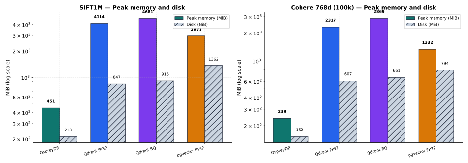
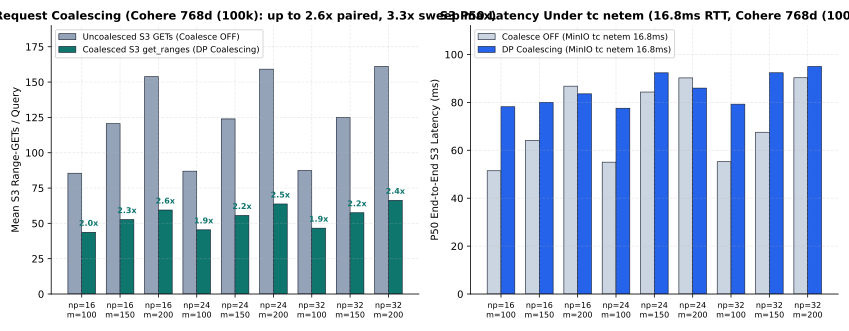

# OspreyDB Benchmarks

[](./LICENSE)

Reproducible benchmark suite for **[OspreyDB](https://github.com/ospreydb/osprey-engine)**. Evaluates three subsystems against production baselines: recall-matched single-vector ANN search (`OspreyDB` 1-bit RaBitQ + `f16` rescore vs. `Qdrant` HNSW FP32, `Qdrant` 1-bit Binary Quantization, and `pgvector` HNSW FP32), late-interaction reranking (`LUT-Rank` AVX-512 CPU vs. ColBERTv2 on CPU and CUDA GPU), and object-storage vector search (DP range coalescing with Hilbert page layout over MinIO with `tc netem 15ms` latency).

## Results

### SIFT1M (1M × 128d)

Recall-matched evaluation (`Recall@10` targets `0.95` and `0.97`, 925 unique test queries, 16 concurrent workers for QPS, OspreyDB bounded to a 256 MiB page cache). Raw data: [`results/compare_engines_controlled.csv`](results/compare_engines_controlled.csv).

| Engine | Target | R@10 | P50 (ms) | P95 (ms) | QPS (16w) | RAM (MiB) | Disk (MiB) | Build (s) |
| :--- | ---: | ---: | ---: | ---: | ---: | ---: | ---: | ---: |
| **OspreyDB** | 0.95 | 0.9641 | 2.98 | 3.41 | 783 | **462** | **213** | **17.5** |
| **OspreyDB** | 0.97 | 0.9738¹ | 3.43 | 3.91 | 784 | **462** | **213** | **17.5** |
| Qdrant FP32 | 0.95 | 0.9672 | 0.85 | 0.94 | 834 | 4,195 | 868 | 34.9 |
| Qdrant FP32 | 0.97 | 0.9905 | 0.89 | 0.98 | 828 | 4,195 | 868 | 34.9 |
| Qdrant 1-bit BQ | 0.95 | 0.0624 (miss) | 0.73 | 0.85 | 790 | 4,781 | 911 | 28.3 |
| Qdrant 1-bit BQ | 0.97 | 0.0624 (miss) | 0.75 | 0.87 | 849 | 4,781 | 911 | 28.3 |
| pgvector FP32 | 0.95 | 0.9726 | 2.37 | 2.89 | 1,793 | 2,594 | 2,144 | 306.5 |
| pgvector FP32 | 0.97 | 0.9863 | 3.26 | 3.95 | 1,349 | 2,594 | 2,144 | 306.5 |

¹ Marked `below_target` on the 375-query validation split (`0.9680`); meets the `0.97` target on the 925-query test split (`0.9738`).

- **Latency vs. footprint:** Qdrant FP32 achieves the lowest sequential P50 (`0.85–0.89 ms` vs. OspreyDB `2.98–3.43 ms`) by keeping the unquantized HNSW graph in RAM (`4,195 MiB`). OspreyDB uses **9.1× less peak RAM** (`462 MiB`), **4.1× less disk** (`213 MiB`), and builds **2.0× faster** (`17.5 s` vs. `34.9 s`, and `17.5×` faster than `pgvector`).
- **1-bit quantization at 128d:** Qdrant 1-bit BQ (`always_ram=true, rescore=true, ef=256, oversampling=3.0`) collapses to `R@10 = 0.0624` on 128d SIFT vectors. OspreyDB's 1-bit RaBitQ Stage-1 + `f16` Stage-2 rescore reaches `0.9738`.

### Cohere (100k × 768d)

550 unique test queries (250 calibration, 200 warmup, 550 test). Raw data: [`results/compare_engines_controlled.csv`](results/compare_engines_controlled.csv).

| Engine | Target | R@10 | P50 (ms) | P95 (ms) | QPS (16w) | RAM (MiB) | Disk (MiB) | Build (s) |
| :--- | ---: | ---: | ---: | ---: | ---: | ---: | ---: | ---: |
| **OspreyDB** | 0.95 | 0.9669 | 0.80 | 0.96 | 908 | **235** | **152** | 19.6 |
| **OspreyDB** | 0.97 | **0.9889** | 0.97 | 1.18 | 913 | **235** | **152** | 19.6 |
| Qdrant FP32 | 0.95 | 0.9647 | 0.70 | 0.78 | 860 | 2,731 | 1,368² | 16.8 |
| Qdrant FP32 | 0.97 | 0.9855 | 0.86 | 0.97 | 820 | 2,731 | 1,368² | 16.8 |
| Qdrant 1-bit BQ | 0.95 | 0.9342 (miss) | 0.68 | 0.74 | 863 | 2,799 | 661² | 14.9 |
| Qdrant 1-bit BQ | 0.97 | 0.9342 (miss) | 0.70 | 0.79 | 846 | 2,799 | 661² | 14.9 |
| pgvector FP32 | 0.95 | 0.9771 | 1.79 | 2.22 | 2,290 | 1,332 | 1,184 | 64.0 |
| pgvector FP32 | 0.97 | 0.9771 | 1.78 | 2.23 | 2,282 | 1,332 | 1,184 | 64.0 |

² Sampled before background compaction finished (`804 MiB` for FP32 and `355 MiB` for BQ after shutdown; OspreyDB remains **5.3×** and **2.3×** smaller).

- At 768 dimensions, OspreyDB matches sub-millisecond P50 latency (`0.80–0.97 ms` vs. Qdrant FP32 `0.70–0.86 ms` and `pgvector` `1.78–1.79 ms`) while using **11.6× less RAM** than Qdrant (`235 MiB` vs. `2,731 MiB`) and **5.7× less RAM** than `pgvector` (`1,332 MiB`).




Additional controlled plots: [Index Build Time (`fig3`)](results/figures/fig3_build_time_controlled.svg) · [Validation vs. Test Recall (`fig4`)](results/figures/fig4_validation_test_recall_controlled.svg).

### Late-Interaction Reranking: `LUT-Rank` vs. ColBERTv2

Reranking 200 candidate passages per query across 100 queries on MS MARCO, BEIR SciFact, and BEIR FiQA. `†` denotes the fastest CPU engine. Raw data: [`results/lutrank_vs_colbert.csv`](results/lutrank_vs_colbert.csv).

| Dataset | Engine | Device | P50 (ms) | P99 (ms) | QPS | NDCG@10 | MRR@10 | Index (MiB) |
| :--- | :--- | :--- | ---: | ---: | ---: | ---: | ---: | ---: |
| **MS MARCO** | **OspreyDB LUT-Rank** | **AVX-512 CPU** | **0.329†** | 0.552 | **2,849†** | 0.7768 | 0.7389 | **97.2** |
| MS MARCO | ColBERTv2 (PyTorch) | CPU | 0.416 | **0.534†** | 2,301 | 0.7876 | 0.7530 | 768.4 |
| MS MARCO | ColBERTv2 (ONNX Runtime) | CPU | 0.476 | 0.733 | 2,005 | 0.7876 | 0.7530 | 768.4 |
| MS MARCO | ColBERTv2 Exact (NumPy) | BLAS CPU | 0.801 | 0.899 | 1,217 | 0.7876 | 0.7530 | 768.4 |
| MS MARCO | ColBERTv2 (PyTorch) | CUDA GPU | 0.226 | 0.308 | 4,134 | 0.7876 | 0.7530 | 768.4 |
| **SciFact** | **OspreyDB LUT-Rank** | **AVX-512 CPU** | 0.505 | **0.551†** | 2,122 | 0.5854 | 0.5437 | **10.2** |
| SciFact | ColBERTv2 (PyTorch) | CPU | 0.345 | 1.584 | **2,398†** | 0.5999 | 0.5629 | 81.0 |
| SciFact | ColBERTv2 (ONNX Runtime) | CPU | **0.338†** | 4.574 | 1,365 | 0.5999 | 0.5629 | 81.0 |
| SciFact | ColBERTv2 Exact (NumPy) | BLAS CPU | 0.679 | 0.849 | 1,453 | 0.5999 | 0.5629 | 81.0 |
| SciFact | ColBERTv2 (PyTorch) | CUDA GPU | 0.207 | 0.703 | 2,581 | 0.6006 | 0.5638 | 81.0 |
| **FiQA** | **OspreyDB LUT-Rank** | **AVX-512 CPU** | 0.519 | 0.722 | 2,006 | 0.4257 | 0.4965 | **112.8** |
| FiQA | ColBERTv2 (PyTorch) | CPU | **0.428†** | **0.532†** | **2,220†** | 0.4372 | 0.5122 | 892.0 |
| FiQA | ColBERTv2 (ONNX Runtime) | CPU | 0.469 | 4.090 | 1,050 | 0.4372 | 0.5122 | 892.0 |
| FiQA | ColBERTv2 Exact (NumPy) | BLAS CPU | 0.864 | 0.955 | 1,143 | 0.4372 | 0.5122 | 892.0 |
| FiQA | ColBERTv2 (PyTorch) | CUDA GPU | 0.229 | 0.338 | 4,126 | 0.4389 | 0.5137 | 892.0 |

- `LUT-Rank` (`vpshufb` 4-bit lookup tables synthesized in `6.7–10.8 µs/query`) compresses `.osr` token lattices **7.9×** versus ColBERTv2 across all three datasets (`97.2 MiB` vs. `768.4 MiB` on MS MARCO) while retaining `98.6%` of exact `NDCG@10` and leading CPU throughput (`2,849 QPS`, `0.329 ms` P50) on MS MARCO.


### Object Storage Search: DP Range Coalescing over MinIO (`tc netem 15ms`)

39-point `nprobe × refine_m` sweep on Cohere 768d stored in MinIO with kernel-injected `tc netem delay 15ms` (`17.0 ms` measured RTT). Raw data: [`results/pareto_s3.csv`](results/pareto_s3.csv).

- At `Recall@10 = 0.960` (`nprobe=32, refine_m=200`), Hilbert-curve page layout + DP range coalescing merges `158.6` candidate `.osv` pages into **18.5 S3 Range-GETs** (**8.6× fewer requests** than uncoalesced fetching), reaching up to **15.2×–49.3×** fewer GETs at higher `refine_m / nprobe` ratios while keeping `VmHWM` under `103 MiB`.




## Protocol & Caveats

Full methodology and per-dataset breakdown: [`results/compare_engines_controlled.md`](results/compare_engines_controlled.md).

- **Asymmetric cache budget:** OspreyDB runs with an explicit 256 MiB page-cache cap (`--controlled-cache-mb 256`), whereas Qdrant and `pgvector` containers are allowed to hold their entire indexes in the host page cache. This favors the competitors on P50 latency and isolates OspreyDB's bounded-RAM execution path.
- **Peak memory accounting (`VmHWM` vs. `cgroup v2 memory.peak`):** Native OspreyDB is measured via `/proc/<pid>/status` `VmHWM`. Dockerized Qdrant and `pgvector` are measured via container `cgroup v2 memory.peak`, which captures page-cache-resident index blocks (preventing the false `148 MiB` process-only RSS reading in `pgvector`).
- **Disjoint splits and zero query repetition:** Calibration uses 25% of the query set (375 queries on SIFT1M, 250 on Cohere) with strict `Recall@10 >= target` filtering. Latency and recall are measured over 200 warmup queries followed by all remaining unique test queries (925 on SIFT1M, 550 on Cohere) across 3 rounds, with no repeated queries.
- **Cohere 100k scale:** The Cohere Wikipedia 768d benchmark uses the 100,000-vector subset (1,000 total queries), not 1M vectors.
- **Qdrant post-compaction disk size:** The `1,368 MiB` (FP32) and `661 MiB` (BQ) Cohere disk figures in `compare_engines_controlled.csv` were sampled before Qdrant's background optimizer finished compaction; post-shutdown collection directories measure `804 MiB` (FP32) and `355 MiB` (BQ), versus `152 MiB` for OspreyDB.
- **Localhost client-server transport:** OspreyDB is served via `osprey-bench-runner serve` over HTTP localhost (matching Qdrant's HTTP path, with JSON request bodies pre-serialized outside the timed loop), while `pgvector` uses SQL over localhost (`psycopg`). Under 16-worker concurrency, HTTP client queueing dominates client P99 tails for both OspreyDB and Qdrant; consult `server_p50_ms_median` and `concurrent_server_p99_ms_median` in the CSV alongside QPS.

## Reproduction

Requires Linux (`x86_64` with AVX-512 recommended), Python 3.10+, Rust toolchain, Docker Compose v2, and a sibling checkout of [`ospreydb/osprey-engine`](https://github.com/ospreydb/osprey-engine) at `../osprey-engine`.

```bash
# 1. Create .venv and install Python dependencies
make setup

# 2. Build native osprey-engine CLI and osprey-bench-runner (-C target-cpu=native)
make build-rust OSPREY_SRC=../osprey-engine

# 3. Validate Python scripts, Rust formatting, and Docker Compose config
make check

# 4. Run the recall-matched controlled benchmark (OspreyDB, Qdrant FP32/BQ, pgvector)
make bench-compare-controlled OSPREY_SRC=../osprey-engine

# 5. Or run the full pipeline (datasets -> MinIO/Docker -> controlled + legacy ANN ->
#    LUT-Rank -> DP Coalescing S3 Pareto -> perf/ISA audit -> SVG plots)
make bench-all OSPREY_SRC=../osprey-engine
```

Individual targets (`make datasets`, `make minio-up`, `make bench-lutrank`, `make bench-pareto`, `make profile-perf`, `make plots`) are documented in [`Makefile`](Makefile).

### Stage-1 Sizing & Adaptive Oversampling (`SearchOptions::resolve`)

`osprey-bench-runner` delegates Stage-1 candidate sizing to `osprey_core::SearchOptions::resolve` ([`rust/src/main.rs`](rust/src/main.rs)):

- When `candidates = 0` (the default when `--refine-m` is omitted), `SearchOptions::resolve` selects `2000` candidates for `orig_dim <= 256` and `300` for `orig_dim > 256`.
- When `refine_multiplier = 0` (adaptive default), `orig_dim <= 256` doubles `nprobe` and `candidates` (`nprobe=16, refine_m=1500` → effective `32/3000` on 128d SIFT1M, bounded by the `top_m <= 4096` Stage-1 heap limit) and enforces a 128-vector exact-`f16` rescore floor. For `orig_dim > 256` (e.g., Cohere 768d), `effective == requested`.
- Pass `--refine-multiplier 1` to disable adaptive doubling or run `make bench-compare-adaptive OSPREY_SRC=../osprey-engine` / `make bench-pareto-adaptive OSPREY_SRC=../osprey-engine` to reproduce the isolated A/B sweeps in `results/compare_engines_adaptive.csv` and `results/pareto_s3_adaptive.csv`.

## Published Artifacts (`results/`)

- [`results/compare_engines_controlled.csv`](results/compare_engines_controlled.csv) & [`results/compare_engines_controlled.md`](results/compare_engines_controlled.md) — Recall-matched (`0.95` / `0.97`) evaluation of OspreyDB, Qdrant FP32, Qdrant 1-bit BQ, and `pgvector` FP32.
- [`results/compare_engines.csv`](results/compare_engines.csv) & [`results/compare_engines_adaptive.csv`](results/compare_engines_adaptive.csv) — Uncalibrated default comparison and isolated `refine_multiplier` A/B sweep on SIFT1M.
- [`results/lutrank_vs_colbert.csv`](results/lutrank_vs_colbert.csv) — `LUT-Rank` AVX-512 CPU vs. ColBERTv2 (PyTorch CPU/CUDA, ONNX Runtime, NumPy BLAS) on MS MARCO, SciFact, and FiQA.
- [`results/pareto_s3.csv`](results/pareto_s3.csv) & [`results/pareto_s3_adaptive.csv`](results/pareto_s3_adaptive.csv) — DP range coalescing ON vs. OFF Pareto sweeps over MinIO with `tc netem 15ms`.
- [`results/sift1m_adaptive_recall_recovery.json`](results/sift1m_adaptive_recall_recovery.json) — Stage-1 adaptive oversampling recall recovery telemetry on SIFT1M.
- [`results/perf/`](results/perf/) — `perf stat` / `rusage` logs, `objdump` AVX-512 instruction counts (`prefetcht0`, `vpopcntq`, `vpshufb`, `vpternlogq`), and JSON stage breakdowns.
- [`results/figures/`](results/figures/) — Vector SVG plots (`fig1`–`fig7`) generated by [`scripts/generate_plots.py`](scripts/generate_plots.py).

## License

Licensed under the [Apache License, Version 2.0](./LICENSE).
