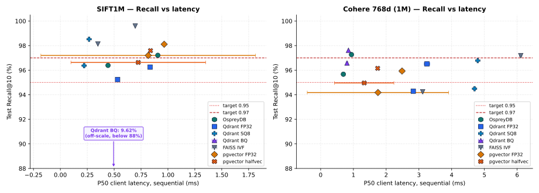
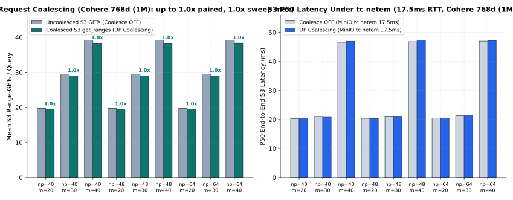

# OspreyDB Benchmarks

[](./LICENSE)

Reproducible benchmark suite for **[OspreyDB](https://github.com/ospreydb/ospreydb)**. Evaluates three subsystems against production baselines: recall-matched single-vector ANN search (`OspreyDB` 1-bit RaBitQ + `f16` rescore vs. `Qdrant` HNSW FP32 / INT8 SQ8 / 1-bit BQ, and `pgvector` HNSW FP32 / FP16 `halfvec`), late-interaction reranking (`LUT-Rank` AVX-512 CPU vs. ColBERTv2 on CPU and CUDA GPU), and object-storage vector search (DP range coalescing with Hilbert page layout over MinIO with `tc netem 15ms` latency).

## Results

### SIFT1M (1M × 128d)

Recall-matched VLDB evaluation (`Recall@10` targets `0.95` and `0.97`, 925 unique test queries, 16 concurrent workers, L2-normalized SIFT1M vectors, OspreyDB running as its containerized production `osprey serve --role unified` server with WAL/LSM/CoW active and `--controlled-cache-mb 256`, Qdrant v1.20.2 FP32/SQ8/BQ via Rust `http-load`, `pgvector` 0.8.7 FP32/`halfvec` via Rust `tokio-postgres`, FAISS `IndexIVFFlat` in-process, and symmetric query-only `cgroup v2 memory.peak` after post-build page-cache eviction). Raw data: [`results/compare_engines_controlled.csv`](results/compare_engines_controlled.csv).

| Engine | Target | R@10 | P50 (ms) | P95 (ms) | QPS (16w) | RAM (MiB) | Disk (MiB) | Build (s) |
| :--- | ---: | ---: | ---: | ---: | ---: | ---: | ---: | ---: |
| **OspreyDB** | 0.95 | 0.9641 | 6.83 | 9.59 | 243 | **1,072** | **213** | 16.9 |
| **OspreyDB** | 0.97 | 0.9738¹ | 8.29 | 11.81 | 198 | **1,072** | **213** | 16.9 |
| Qdrant FP32 | 0.95 | 0.9524 | 0.53 | 0.65 | 7,548 | 1,483 | 1,123 | 48.4 |
| Qdrant FP32 | 0.97 | 0.9625 (miss) | 0.83 | 1.00 | 4,522 | 1,483 | 1,123 | 48.4 |
| Qdrant SQ8 | 0.95 | 0.9637 | **0.22** | **0.25** | **20,836** | 1,916 | 1,423 | 74.0 |
| Qdrant SQ8 | 0.97 | 0.9852 | **0.27** | **0.31** | **17,975** | 1,916 | 1,423 | 74.0 |
| Qdrant 1-bit BQ | 0.95 | 0.0962 (miss) | 0.49 | 0.60 | 9,378 | 1,655 | 1,205 | 127.0 |
| Qdrant 1-bit BQ | 0.97 | 0.0962 (miss) | 0.50 | 0.60 | 9,653 | 1,655 | 1,205 | 127.0 |
| pgvector FP32 | 0.95 | 0.9720 | 0.82 | 1.04 | 6,513 | 1,928 | 1,362 | 197.4 |
| pgvector FP32 | 0.97 | 0.9811 | 0.96 | 1.24 | 5,810 | 1,928 | 1,362 | 197.4 |
| pgvector halfvec | 0.95 | 0.9663 | 0.72 | 0.92 | 8,296 | 1,407 | 847 | 87.9 |
| pgvector halfvec | 0.97 | 0.9759 | 0.84 | 1.12 | 7,373 | 1,407 | 847 | 87.9 |
| FAISS IVF | 0.95 | **0.9865** | 0.64 | 0.77 | 1,939 | 1,400 | 0 | **0.4** |
| FAISS IVF | 0.97 | **0.9865** | 0.64 | 0.76 | 1,928 | 1,400 | 0 | **0.4** |

¹ Marked `below_target` on the 375-query validation split (`0.9680`); meets the `0.97` target on the 925-query test split (`0.9738`).

- **Footprint & build speed:** OspreyDB leads all engines in query peak memory (`1,072.2 MiB` cgroup peak; `844.5 MiB` process `VmHWM`) and disk (`212.95 MiB`, **4.0×–6.7× smaller**), while building **2.9×–11.7× faster** than containerized Qdrant and `pgvector` (`16.9 s` vs `48.4–197.4 s`; in-memory FAISS IVF builds in `0.44 s`).
- **Latency & quantization:** Qdrant INT8 SQ8 achieves the fastest SIFT1M latency (`0.22–0.27 ms` P50, `20,836 QPS`) and `pgvector halfvec` reaches `0.72–0.84 ms` P50 (`8,296 QPS`), whereas Qdrant 1-bit BQ (`always_ram=true, rescore=true, ef=384, oversampling=30.0`) collapses to `R@10 = 0.0962`. OspreyDB's containerized server reaches `0.9641 / 0.9738` recall at `6.83 / 8.29 ms` P50 (`243 / 198 QPS`).

### Cohere (1M × 768d)

550 unique test queries (250 calibration, 200 warmup, 550 test) over 1,000,000 768d embeddings. Raw data: [`results/compare_engines_controlled.csv`](results/compare_engines_controlled.csv).

| Engine | Target | R@10 | P50 (ms) | P95 (ms) | QPS (16w) | RAM (MiB) | Disk (MiB) | Build (s) |
| :--- | ---: | ---: | ---: | ---: | ---: | ---: | ---: | ---: |
| **OspreyDB** | 0.95 | 0.9620 | 4.38 | 4.96 | 671 | **2,080** | **1,514** | 184.3 |
| **OspreyDB** | 0.97 | 0.9620 (miss) | 4.36 | 4.95 | 677 | **2,080** | **1,514** | 184.3 |
| Qdrant FP32 | 0.95 | 0.9429 (miss) | 2.83 | 3.22 | 546 | 6,496 | 6,003 | 1,133.6 |
| Qdrant FP32 | 0.97 | 0.9651 (miss) | 3.25 | 3.67 | 457 | 6,496 | 6,003 | 1,133.6 |
| Qdrant SQ8 | 0.95 | 0.9449 (miss) | 4.70 | 5.07 | 417 | 6,451 | 5,842 | 1,080.5 |
| Qdrant SQ8 | 0.97 | 0.9678 (miss) | 4.80 | 5.30 | 406 | 6,451 | 5,842 | 1,080.5 |
| Qdrant 1-bit BQ | 0.95 | 0.9658 | **0.81** | **0.96** | **4,870** | 4,851 | 4,455 | 773.9 |
| Qdrant 1-bit BQ | 0.97 | 0.9762 | **0.85** | **1.09** | **4,212** | 4,851 | 4,455 | 773.9 |
| pgvector FP32 | 0.95 | 0.9418 (miss) | 1.75 | 2.88 | 2,351 | 6,307 | 7,935 | 1,656.0 |
| pgvector FP32 | 0.97 | 0.9593 (miss) | 2.48 | 3.61 | 1,757 | 6,307 | 7,935 | 1,656.0 |
| pgvector halfvec | 0.95 | 0.9496 (miss) | 1.33 | 2.11 | 3,039 | 4,249 | 3,537 | 580.4 |
| pgvector halfvec | 0.97 | 0.9615 (miss) | 1.74 | 2.48 | 2,505 | 4,249 | 3,537 | 580.4 |
| FAISS IVF | 0.95 | 0.9404 (miss) | 5.19 | 6.20 | 290 | 6,998 | 0 | **6.8** |
| FAISS IVF | 0.97 | **0.9787** | 10.23 | 11.59 | 148 | 6,998 | 0 | **6.8** |

- **2.0×–3.4× less RAM & 2.3×–5.2× less disk:** At 1M × 768d, OspreyDB keeps total query peak RAM at `2,080.4 MiB` (`557.6 MiB` process `VmHWM`) and disk at `1,514.2 MiB`, versus `6,496 MiB` / `6,003 MiB` for Qdrant FP32 (**3.1×** RAM, **4.0×** disk), `6,451 MiB` / `5,842 MiB` for Qdrant SQ8 (**3.1×** RAM, **3.9×** disk), `6,307 MiB` / `7,935 MiB` for `pgvector` FP32 (**3.0×** RAM, **5.2×** disk), `4,249 MiB` / `3,537 MiB` for `pgvector halfvec` (**2.0×** RAM, **2.3×** disk), and `6,998 MiB` `VmHWM` for FAISS IVF (**3.4×** RAM).
- **Throughput & calibration note:** OspreyDB builds **3.1×–9.0× faster** (`184.3 s` vs `580–1,656 s`) and outperforms Qdrant FP32 (`546 / 457 QPS`), Qdrant SQ8 (`417 / 406 QPS`), and FAISS IVF (`290 / 148 QPS`) in concurrent QPS (`671 / 677 QPS`). On origin-centered 768d vectors with unlocked `oversampling` (`20.0–30.0`), Qdrant BQ meets both targets (`0.9658 / 0.9762`) at `4,870 / 4,212 QPS` using `4,851 MiB` peak RAM (**2.3×** OspreyDB). On the 0.97 calibration split, OspreyDB (`0.9720 -> 0.9620`), Qdrant FP32/SQ8, and `pgvector` slightly under-shot `0.97` on the 550-query test split.




Additional controlled plots: [Index Build Time (`fig3`)](results/figures/fig3_build_time_controlled.svg) · [Validation vs. Test Recall (`fig4`)](results/figures/fig4_validation_test_recall_controlled.svg).

### Late-Interaction Reranking: `LUT-Rank` vs. ColBERTv2

Reranking 200 candidate passages per query across 100 queries on MS MARCO, BEIR SciFact, and BEIR FiQA. `†` denotes the fastest CPU engine. Raw data: [`results/lutrank_vs_colbert.csv`](results/lutrank_vs_colbert.csv).

> **Input & Workload Disclosure:** The published numbers below use **synthetic 128d BLAKE2b trigram-hashed token vectors (`32` doc tokens × `12` query tokens) with oracle `qrels` + deterministic negatives**, NOT neural `colbert-ir/colbertv2.0` embeddings (which are anisotropic and `120–180 × 32` tokens). Re-evaluation with real neural ColBERTv2 embeddings is tracked in the harness upgrade.

| Dataset | Engine | Device | P50 (ms) | P99 (ms) | QPS | NDCG@10 | MRR@10 | Index (MiB) |
| :--- | :--- | :--- | ---: | ---: | ---: | ---: | ---: | ---: |
| **MS MARCO** | **OspreyDB LUT-Rank** | **AVX-512 CPU** | **0.329†** | 0.552 | **2,849†** | 0.7768 | 0.7389 | **97.2** |
| MS MARCO | ColBERTv2 (PyTorch) | CPU | 0.416 | **0.534†** | 2,301 | 0.7876 | 0.7530 | 768.4 |
| MS MARCO | ColBERTv2 (ONNX Runtime) | CPU | 0.476 | 0.733 | 2,005 | 0.7876 | 0.7530 | 768.4 |
| MS MARCO | ColBERTv2 Exact (NumPy) | BLAS CPU | 0.801 | 0.899 | 1,217 | 0.7876 | 0.7530 | 768.4 |
| MS MARCO | ColBERTv2 (PyTorch) | CUDA GPU | 0.226 | 0.308 | 4,134 | 0.7876 | 0.7530 | 768.4 |
| **SciFact** | **OspreyDB LUT-Rank** | **AVX-512 CPU** | 0.505 | **0.551†** | 2,122 | 0.5854 | 0.5437 | **10.2** |
| SciFact | ColBERTv2 (PyTorch) | CPU | 0.345 | 1.584 | **2,398†** | 0.5999 | 0.5629 | 81.0 |
| SciFact | ColBERTv2 (ONNX Runtime) | CPU | **0.338†** | 4.574 | 1,365 | 0.5999 | 0.5629 | 81.0 |
| SciFact | ColBERTv2 Exact (NumPy) | BLAS CPU | 0.679 | 0.849 | 1,453 | 0.5999 | 0.5629 | 81.0 |
| SciFact | ColBERTv2 (PyTorch) | CUDA GPU | 0.207 | 0.703 | 2,581 | 0.6006 | 0.5638 | 81.0 |
| **FiQA** | **OspreyDB LUT-Rank** | **AVX-512 CPU** | 0.519 | 0.722 | 2,006 | 0.4257 | 0.4965 | **112.8** |
| FiQA | ColBERTv2 (PyTorch) | CPU | **0.428†** | **0.532†** | **2,220†** | 0.4372 | 0.5122 | 892.0 |
| FiQA | ColBERTv2 (ONNX Runtime) | CPU | 0.469 | 4.090 | 1,050 | 0.4372 | 0.5122 | 892.0 |
| FiQA | ColBERTv2 Exact (NumPy) | BLAS CPU | 0.864 | 0.955 | 1,143 | 0.4372 | 0.5122 | 892.0 |
| FiQA | ColBERTv2 (PyTorch) | CUDA GPU | 0.229 | 0.338 | 4,126 | 0.4389 | 0.5137 | 892.0 |

- `LUT-Rank` (`vpshufb` 4-bit lookup tables synthesized in `6.7–10.8 µs/query`) compresses `.osr` token lattices **7.9×** versus ColBERTv2 across all three datasets (`97.2 MiB` vs. `768.4 MiB` on MS MARCO), which is its primary advantage across all three datasets, while retaining `98.6%` of exact `NDCG@10` on MS MARCO. In latency/throughput, `LUT-Rank` leads CPU on MS MARCO (`2,849 QPS`, `0.329 ms` P50), whereas **PyTorch CPU was faster in P50/QPS on SciFact and FiQA** (`0.345 / 0.428 ms` P50 and `2,398 / 2,220 QPS` vs. LUT-Rank's `0.505 / 0.519 ms` and `2,122 / 2,006 QPS`).


### Object Storage Search: DP Range Coalescing over MinIO (`tc netem 15ms`)

39-point `nprobe × refine_m` sweep on Cohere 768d (1M vectors: `145.5 MiB` `.osi` + `1,368.7 MiB` `.osv`) stored in MinIO with kernel-injected `tc netem delay 15ms` (`16.38 ms` measured RTT, `200` queries, `--cache-mb 0`). Raw data: [`results/pareto_s3.csv`](results/pareto_s3.csv).

- At `Recall@10 = 0.9565` (`nprobe=32, refine_m=150`), Hilbert-curve page layout + DP range coalescing (`tau_req = 256 KiB`) merges `145.2` candidate `.osv` pages into **127.4 S3 Range-GETs** (`108.7 ms` P50); at `Recall@10 = 0.9720` (`nprobe=48, refine_m=200`), it merges `192.5` pages into **163.5 S3 Range-GETs** (**1.18× fewer requests**, `118.6 ms` P50), reaching **0.9790 recall** at `48/300` (`226.3` GETs vs. `285.1` raw pages, `145.5 ms` P50) and up to **1.33×** fewer GETs at `4/300` (`269.4 -> 201.8 GETs`) while keeping local `VmHWM` between **`321.7 MiB` and `362.6 MiB`** with zero local `.osv` disk or slab cache.
- **Coalescing & scale trade-offs:** Across 1M vectors (`~383k` minipages in `.osv`), candidate pages are ~10× sparser in object-byte offset than at 100k scale, so DP coalescing reduces S3 Range-GETs by **1.04×–1.33×** while reading slightly wider contiguous byte spans (`2.73 MB` vs `1.87 MB` at `32/150`). Moreover, low-dimensional 128d SIFT1M requires **`~647 GETs / 48.7 MB` per query** for `0.969` recall ([`results/sift1m_adaptive_recall_recovery.json`](results/sift1m_adaptive_recall_recovery.json)), making high-dimensional embeddings (`768d+`) the sweet spot for S3-backed search.




## Methodology & FAQ for Skeptics

Full protocol and per-dataset breakdown: [`results/compare_engines_controlled.md`](results/compare_engines_controlled.md).

1. **Why Qdrant 1-bit BQ collapses on SIFT1M (`R@10 = 0.0962`) vs. Cohere 768d (`0.9762`), while OspreyDB RaBitQ reaches `0.9738` / `0.9620`:**
   SIFT1M descriptors are non-negative ($\mathbf{x} \in \mathbb{R}_{\ge 0}^{128}$). Standard 1-bit binary quantization takes $\operatorname{sign}(\mathbf{x})$ without centering, mapping almost every coordinate in the positive orthant to `111...1` and destroying Hamming distance discrimination. Cohere 768d embeddings are centered near the origin, so uncentered sign quantization works well (`0.9762` with `oversampling=30.0`). OspreyDB's `RaBitQ` quantizes the **centroid-centered residual** ($\mathbf{x} - \mathbf{c}$) after a randomized Fast Walsh-Hadamard Transform (FWHT) rotation, ensuring balanced variance across all rotated coordinates regardless of input orthant bias, followed by exact `f16` Stage-2 rescoring.
2. **Containerized production serving (`osprey_docker`) and Rust client parity:**
   In `compare_engines_controlled.csv`, OspreyDB runs inside its production Docker container (`osprey serve --role unified`, with WAL, LSM, and CoW compactor active), and OspreyDB and Qdrant are driven by the exact same compiled Rust HTTP/1.1 keep-alive load client (`osprey-bench-runner http-load`) over Docker bridge networking (`server_p50_ms_median` is also exported separately). `pgvector` uses a compiled Rust `tokio-postgres` SQL client (`pg_load`) over the Docker bridge, with server execution time sampled on 100 queries via `EXPLAIN ANALYZE`, and FAISS `IndexIVFFlat` runs in-process. `build_time_s` mixes local Parquet import (`osprey import`) with batch ingestion + HNSW indexing for Qdrant and `pgvector`.
3. **Local NVMe memory (`cgroup v2 memory.peak` / `VmHWM`) vs. S3 zero-slab-RAM:**
   In the local NVMe controlled benchmark, `--controlled-cache-mb 256` covers the SIFT1M `.osv` slab (`213 MiB` total) and partially caches Cohere 1M (`1,514 MiB` total); OspreyDB's `1,072.2 MiB` (SIFT1M) and `2,080.4 MiB` (Cohere 1M) `cgroup v2 memory.peak` figures (and `844.5 MiB` / `557.6 MiB` process `VmHWM`) include Linux OS page-cache pages touched while reading the local `.osv` slab file. In the S3 object-storage benchmark ([`results/pareto_s3.csv`](results/pareto_s3.csv), `--cache-mb 0`), the `1,368.7 MiB` `.osv` slab lives 100% in MinIO/S3, so OspreyDB only holds the 1-bit `.osi` index (`145.5 MiB`), directory, and transient Range-GET buffers—keeping total local `VmHWM` at **`321.7–362.6 MiB`** (and `111–184 MiB` adaptive / `98–144 MiB` baseline on SIFT1M per [`results/pareto_s3_adaptive.csv`](results/pareto_s3_adaptive.csv)).
4. **100M-vector S3 vs. RAM TCO formula (back-of-the-envelope lower bound):**
   Because `.osi` + `.osv` footprints scale linearly with vector count ($N$), the 100M-vector cloud storage footprint and request cost can be extrapolated 100× from the 1M Cohere artifact (`145.5 MiB` `.osi` + `1,368.7 MiB` `.osv`):
   $$\text{Monthly Cost}_{\text{S3}} = \text{GB}_{\text{osi+osv}} \times \$0.023/\text{GB-mo} + \frac{Q_{\text{month}} \times \text{GETs/query}}{1000} \times \$0.0004 + \text{EC2}_{\text{compute}}$$
   Scaling 100× from 1M to 100M 768d vectors yields `~14.2 GiB` `.osi` (in RAM) + `~133.7 GiB` `.osv` (in S3) = `147.9 GiB` total (`~$3.40/mo` S3 Standard), plus **`$65.40 per 1M queries`** (`$0.0654 per 1,000 queries` from `1,000,000 × 163.5 / 1,000 × $0.0004`) at `163.5 GETs/query` (`48/200`, `R@10 = 0.9720`) — compared against hosting `~650 GiB` of unquantized FP32 HNSW RAM across memory-optimized EC2 `r6i`/`r7i` instances. **Caveats:** Holding `163.5 GETs/query` constant from `1M` to `100M` vectors assumes `nprobe`/`refine_m` scale sub-linearly with cluster count (`clusters` would grow above `256` at 100M), and production competitors also deploy quantized/disk-backed modes (such as Qdrant SQ8/BQ, DiskANN, and `pgvector halfvec`), not only unquantized FP32 HNSW in RAM.
5. **Symmetric accounting & zero query repetition:**
   Every engine is run in isolation, stopped/restarted after index build, and stripped of host OS page cache before calibration (`25%` split) and measurement (`200` warmup + `925` unique SIFT1M / `550` unique Cohere test queries × `3` rounds, `16` concurrent workers).

## Reproduction

Requires Linux (`x86_64` with AVX-512 recommended), Python 3.10+, Rust toolchain, Docker Compose v2, and a sibling checkout of [`ospreydb/ospreydb`](https://github.com/ospreydb/ospreydb) at `../ospreydb`.

```bash
# 1. Create .venv and install Python dependencies
make setup

# 2. Build native osprey CLI and osprey-bench-runner (-C target-cpu=native)
make build-rust OSPREY_SRC=../ospreydb

# 3. Validate Python scripts, CSV/Markdown/SVG consistency, Rust formatting, and Docker Compose config
make check

# 4. Run the recall-matched controlled benchmark (OspreyDB, Qdrant FP32/SQ8/BQ, pgvector FP32/halfvec)
make bench-compare-controlled OSPREY_SRC=../ospreydb

# 5. Or run the full pipeline (datasets -> MinIO/Docker -> controlled + legacy ANN ->
#    LUT-Rank -> DP Coalescing S3 Pareto -> perf/ISA audit -> SVG plots)
make bench-all OSPREY_SRC=../ospreydb
```

Individual targets (`make datasets`, `make minio-up`, `make bench-lutrank`, `make bench-pareto`, `make profile-perf`, `make plots`) are documented in [`Makefile`](Makefile).

### Stage-1 Sizing & Adaptive Oversampling (`SearchOptions::resolve`)

`osprey-bench-runner` delegates Stage-1 candidate sizing to `osprey_core::SearchOptions::resolve` ([`rust/src/main.rs`](rust/src/main.rs)):

- When `candidates = 0` (the default when `--refine-m` is omitted), `SearchOptions::resolve` selects `2000` candidates for `orig_dim <= 256` and `300` for `orig_dim > 256`.
- When `refine_multiplier = 0` (adaptive default), `orig_dim <= 256` doubles `nprobe` and `candidates` (`nprobe=16, refine_m=1500` → effective `32/3000` on 128d SIFT1M, bounded by the `top_m <= 4096` Stage-1 heap limit) and enforces a 128-vector exact-`f16` rescore floor. For `orig_dim > 256` (e.g., Cohere 768d), `effective == requested`.
- Pass `--refine-multiplier 1` to disable adaptive doubling or run `make bench-compare-adaptive OSPREY_SRC=../ospreydb` / `make bench-pareto-adaptive OSPREY_SRC=../ospreydb` to reproduce the isolated A/B sweeps in `results/compare_engines_adaptive.csv` and `results/pareto_s3_adaptive.csv`.

## Published Artifacts (`results/`)

- [`results/compare_engines_controlled.csv`](results/compare_engines_controlled.csv), [`results/compare_engines_controlled.json`](results/compare_engines_controlled.json), [`results/summary.json`](results/summary.json) & [`results/compare_engines_controlled.md`](results/compare_engines_controlled.md) — Recall-matched (`0.95` / `0.97`) evaluation of OspreyDB, Qdrant FP32/SQ8/BQ, and `pgvector` FP32/`halfvec`.
- [`results/compare_engines.csv`](results/compare_engines.csv) & [`results/compare_engines_adaptive.csv`](results/compare_engines_adaptive.csv) — Uncalibrated default comparison and isolated `refine_multiplier` A/B sweep on SIFT1M.
- [`results/lutrank_vs_colbert.csv`](results/lutrank_vs_colbert.csv) — `LUT-Rank` AVX-512 CPU vs. ColBERTv2 (PyTorch CPU/CUDA, ONNX Runtime, NumPy BLAS) on MS MARCO, SciFact, and FiQA.
- [`results/pareto_s3.csv`](results/pareto_s3.csv) & [`results/pareto_s3_adaptive.csv`](results/pareto_s3_adaptive.csv) — DP range coalescing ON vs. OFF Pareto sweeps over MinIO with `tc netem 15ms`.
- [`results/sift1m_adaptive_recall_recovery.json`](results/sift1m_adaptive_recall_recovery.json) — Stage-1 adaptive oversampling recall recovery telemetry on SIFT1M.
- [`results/perf/`](results/perf/) — `perf stat` / `rusage` logs, `objdump` AVX-512 instruction counts (`prefetcht0`, `vpopcntq`, `vpshufb`, `vpternlogq`), and JSON stage breakdowns.
- [`results/figures/`](results/figures/) — Vector SVG plots (`fig1`–`fig7`) generated by [`scripts/generate_plots.py`](scripts/generate_plots.py).

## License

Licensed under the [Apache License, Version 2.0](./LICENSE).
